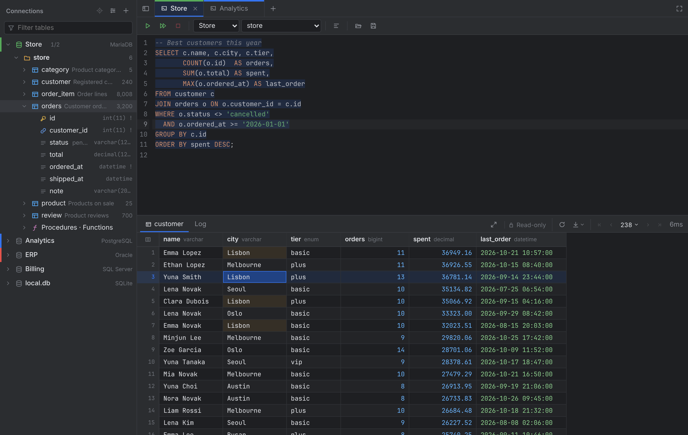
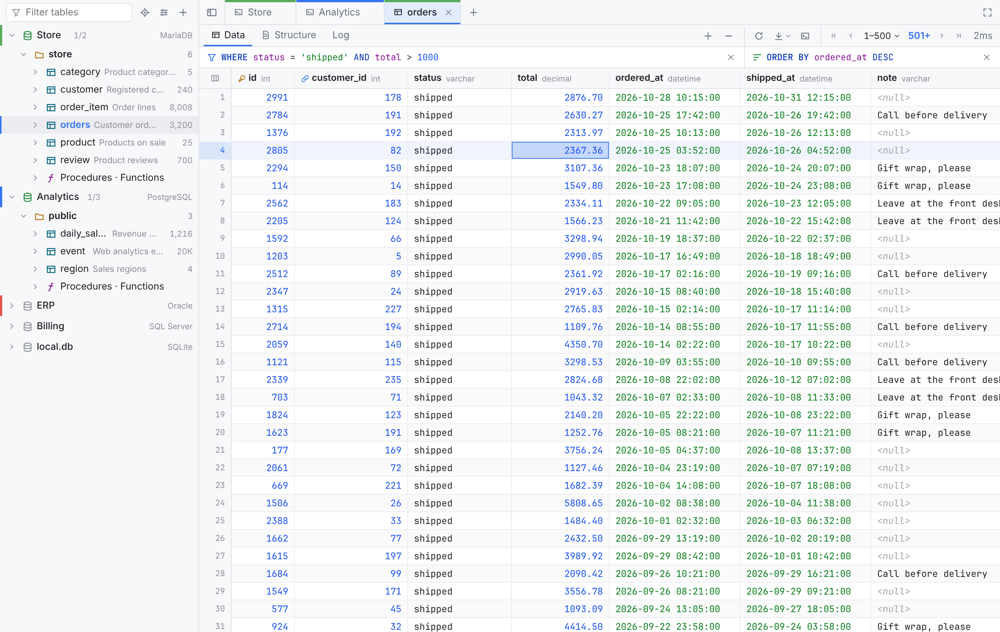

# Tablume

[English](README.md) | **한국어**

DataGrip보다 가볍게 쓰려고 Go로 만든 멀티 DB SQL 클라이언트입니다. macOS와 Windows에서 동작하고, 서버에 띄워 브라우저로 쓰는 [웹 버전](#웹-버전)도 있습니다.



- **지원 DB**: MySQL, MariaDB, Oracle, SQL Server, PostgreSQL, SQLite
- **크기**: 실행 파일 하나, 약 35MB. JVM이나 Chromium을 함께 넣지 않고 OS에 있는 웹뷰를 씁니다. (Windows는 WebView2, macOS는 WKWebView)
- **Oracle Instant Client가 필요 없습니다.** 순수 Go 드라이버([go-ora](https://github.com/sijms/go-ora))를 씁니다.

## 기능

### 연결

- 연결마다 색상을 지정하고 연결을 테스트할 수 있습니다. 비밀번호는 OS 키체인(macOS 키체인, Windows 자격 증명 관리자)에 저장합니다.
- SSH 터널은 비밀번호나 키 파일(암호 걸린 키 포함)로 접속합니다. 처음 연결한 서버의 호스트 키를 저장해 두고, 키가 바뀌면 연결하지 않습니다. 터널이 끊기면 다음 쿼리 때 다시 붙습니다.
- 연결 순서는 끌어서 옮기거나 우클릭 → 맨 위로 / 위로 / 아래로 / 맨 아래로 바꿉니다.
- **읽기 전용 연결**: 연결 설정에서 "읽기 전용"을 켜면 콘솔은 조회 문장(SELECT, SHOW, EXPLAIN 등)만 실행합니다. 스크립트 전체를 실행 전에 검사하고, 데이터 편집, 구조 변경, 테이블·스키마 만들기·삭제를 막습니다. MySQL/MariaDB, PostgreSQL, SQLite는 DB 세션도 읽기 전용으로 열어서 데이터를 바꾸는 함수도 막힙니다. 트리와 탭에 자물쇠가 표시됩니다.
- **연결 내보내기·가져오기**: 보기 옵션 → 연결 목록에서 모든 연결을 JSON 파일로 내보내고 가져옵니다(연결 하나는 우클릭 → 내보내기). SSH, 색상, 표시할 스키마, 추가 옵션은 들어가고 비밀번호(SSH 비밀번호와 키 암호 포함)는 빠집니다. 가져온 연결은 처음 연결할 때 비밀번호를 묻습니다. 이미 있는 연결과 같은 것은 다시 추가하지 않습니다.

### 스키마 트리

- 연결 → 스키마/DB → 테이블/뷰 → 컬럼 순서이고, 컬럼에 PK(🔑), UNIQUE(☆), FK(🔗) 아이콘이 붙습니다.
- 연결 이름 옆 `3/98`(표시 중/전체)로 보일 스키마를 고릅니다. 전체(시스템 스키마 제외), 기본 스키마, 개별 스키마, `HR_*` 같은 패턴을 조합할 수 있고 연결마다 저장됩니다.
- 테이블을 클릭하면 다음 클릭이 재사용하는 미리보기 탭으로 열리고, 더블클릭하면 탭이 고정됩니다. 이미 열린 테이블은 그 탭으로 이동하고, 트리 위의 ⌖ 버튼은 열린 테이블을 트리에서 찾습니다.
- 연결과 스키마는 ▸ 버튼이나 더블클릭으로 펼치고, 키보드(↑↓ 이동, → 펼치기, ← 접기)로도 다룹니다. 스크롤해도 지금 연결 이름은 맨 위에 고정됩니다.
- 테이블 필터는 이미 불러온 스키마 중 일치하는 테이블이 있는 스키마만 보여줍니다.
- 보기 옵션으로 스키마·테이블·컬럼 코멘트, 행 수, 크기를 트리에 표시합니다. 행 수와 크기는 DB 통계의 추정값이고, 옵션을 켠 동안만 조회합니다. 테이블 탭에서 전체 행 수를 세면 트리 값도 바뀝니다.
- 테이블이나 컬럼에 마우스를 올리면 코멘트, 행 수, 크기가 보입니다.
- 스키마 아래 "프로시저 · 함수"에서 루틴 목록을 봅니다(Oracle은 패키지 포함, SQLite 제외). 누르면 소스가 그대로 실행되도록 감싼 채(`DELIMITER`, `GO`, `/`) 콘솔에 열립니다.
- 테이블 우클릭 메뉴: 데이터 보기, DDL 보기, SELECT 문을 콘솔에 넣기, 이름 복사, 이름 바꾸기(`F2`, 열린 탭도 따라감), 데이터 내보내기, CSV 가져오기, 테이블 비우기, 테이블·뷰 삭제. 비우기(`TRUNCATE`, SQLite는 `DELETE`)와 삭제는 확인을 받고, 삭제한 테이블의 탭은 닫힙니다.
- 스키마 우클릭 메뉴: 테이블 만들기, 테이블 목록·루틴 목록(코멘트, 행 수, 크기, 날짜 등 카탈로그 정보를 결과 표로 열어 정렬·필터·내보내기가 됩니다), ERD 보기(MySQL/MariaDB), 코멘트 수정, 스키마 내보내기, 스키마 삭제.
- 스키마 코멘트: MariaDB(10.5 이상)는 데이터베이스 코멘트, PostgreSQL은 `COMMENT ON SCHEMA`, SQL Server는 데이터베이스의 `MS_Description` 속성(SSMS의 "설명")을 트리와 툴팁, 표시할 스키마 목록에 보여 주고, 스키마 메뉴의 "코멘트 수정…"으로 바꿉니다. MySQL, Oracle, SQLite에는 스키마 코멘트가 없습니다.
- 스키마 만들기·삭제: PostgreSQL은 스키마(`DROP SCHEMA … CASCADE`), MySQL/MariaDB와 SQL Server는 데이터베이스를 만들고 지웁니다. 만들기는 연결 메뉴와 스키마 메뉴에 있고, 삭제는 시스템 스키마가 아닐 때만 확인을 받은 뒤 합니다. Oracle과 SQLite는 지원하지 않습니다.
- 콘솔에서 DDL(`CREATE`/`ALTER`/`DROP`/`RENAME`, `CREATE DATABASE`/`SCHEMA`)을 실행하면 트리의 해당 부분을 다시 읽습니다.

### SQL 콘솔

- 탭 여러 개를 열 수 있고, 탭마다 연결과 세션이 따로 유지됩니다. 탭과 SQL은 앱을 다시 켜도 복원되고, `.sql` 파일을 열고 저장할 수 있습니다.
- 커서가 있는 문장(또는 선택 영역)이나 전체 스크립트를 실행합니다. 전체 실행은 오류가 나면 멈춥니다. 실행 중인 쿼리를 취소할 수 있고, 서버가 취소에 응답하지 않으면 3초 뒤 그 탭의 연결을 새로 엽니다.
- DB별 문법 하이라이트, 테이블·컬럼 자동완성, SQL 정렬을 지원합니다.
- 문장은 DB별 규칙으로 나눕니다. Oracle은 PL/SQL 블록을 `/`까지, SQL Server는 `GO` 배치, MySQL은 `DELIMITER`와 `BEGIN … END`, PostgreSQL은 `$$` 인용을 인식합니다. `;` 뒤 같은 줄에 붙은 주석은 그 문장에 속합니다.
- **수동 커밋**: 툴바의 `Tx: 자동 / 수동`으로 바꾸면 변경이 커밋이나 롤백할 때까지 트랜잭션에 남습니다. 트랜잭션은 첫 변경 직전에 시작하고, DDL을 실행하면 끝납니다(MySQL과 Oracle은 DDL이 암묵적으로 커밋합니다). 커밋하지 않은 채 탭을 닫거나, 연결을 끊거나, 자동으로 돌리면 먼저 물어봅니다. 연결이 끊기면 변경이 롤백되었다고 알려 줍니다.
- 어느 연결에서든 자체 `WHERE`가 없는 `UPDATE`·`DELETE`는 바로 실행하지 않고, 해당 문장을 보여 주며 확인을 받습니다.
- Oracle에서 PL/SQL을 만들 때 컴파일 오류가 있으면 SQL\*Plus처럼 오류 내용을 보여줍니다.
- 편집한 SQL이 있는 콘솔(열었을 때나 파일로 저장한 뒤와 달라진 것)을 닫으면 먼저 물어봅니다.

### 결과

- 결과 옆의 시간은 실행, 가져오기, 앱 처리, 표 그리기를 합한 대기 시간이고, 마우스를 올리면 나눠서 보여 줍니다.
- 결과는 페이지 단위로 가져옵니다(기본 500행, 100~10,000). 단순 SELECT에는 `LIMIT/OFFSET`(SQL Server·Oracle 12c+는 `OFFSET … FETCH`)을 붙여 커서가 잠금을 잡고 남지 않게 합니다. 그 밖의 쿼리와 Oracle 11g는 커서로 이어 읽고, 30초 동안 더 읽지 않으면 커서를 닫습니다.
- 스크롤하면 이어서 불러옵니다. 한 번에 최대 1만 행만 들고 있고, 앞쪽 행은 "이전 행 불러오기"로 다시 가져옵니다. 결과 막대에서 페이지 이동, 페이지 크기 변경, 전체 행 수 세기(`COUNT(*)`)를 합니다.
- 가상 스크롤, 셀·범위 선택, TSV·헤더 포함·`IN (…)` 목록 복사를 지원합니다. 셀을 고르면 같은 컬럼의 같은 값이 강조됩니다.
- 컬럼 너비 조절(경계를 더블클릭하면 내용에 맞춤), 끌어서 순서 바꾸기, 숨기기를 할 수 있고, 테이블 탭은 그 배치를 기억합니다. 헤더를 클릭하면 정렬합니다.
- `Ctrl/⌘+F`로 불러온 행에서 글자를 찾고, `Enter`/`Shift+Enter`로 다음/이전으로 갑니다.
- 숫자, 날짜, 불리언을 색으로 구분하고, FLOAT/DOUBLE은 지수 표기 없이 보여줍니다.
- 값 보기 창은 JSON을 색으로 구분하고(접기, 괄호 짝 표시) 정렬할 수 있습니다.
- FK 셀을 `⌘`+클릭(Mac) 또는 `Alt`/`Ctrl`+클릭(Windows)하거나 셀 메뉴의 "참조 행 열기"를 누르면 참조하는 행이 새 탭에 열립니다.
- CSV, TSV, JSON, INSERT 문으로 내보냅니다.
- 에디터를 숨기고 결과만 크게 볼 수 있습니다(확대 버튼, 또는 구분선 더블클릭).

### 테이블 탭

- 테이블은 에디터 없이 결과만 보이는 탭으로 열리고, `데이터 | 구조 | 로그`로 전환합니다. 콘솔 아이콘을 누르면 같은 SELECT를 콘솔에서 엽니다.
- 결과 위의 `WHERE`, `ORDER BY` 칸(DataGrip 방식)에 조건을 넣고 Enter를 누르면 DB에서 다시 조회합니다. 컬럼과 키워드를 자동완성합니다. 헤더 클릭도 DB에서 정렬하고(오름차순 → 내림차순 → 해제), 콘솔 결과에서는 불러온 행만 화면에서 정렬합니다.
- 보기 옵션의 "기본 정렬: PK 내림차순"을 켜면 최신 행부터 엽니다.
- 테이블 탭에도 `Tx: 자동 / 수동` 전환이 있습니다. 수동 커밋에서는 적용한 그리드 편집이 탭의 트랜잭션에 들어가 커밋을 기다리고(적용 한 번은 세이브포인트로 묶여 전부 되거나 전부 안 됩니다), 롤백하면 테이블을 다시 읽습니다.

### 실행 로그

- 로그 칸은 검색할 수 있고 `이 탭 | 이 연결 전체`로 전환합니다.
- SQL이 있는 줄은 연결마다 데이터 폴더에 저장되어(최근 약 3,000줄) 탭을 닫거나 앱을 다시 켜도 남습니다. 콘솔 문장은 쓴 그대로, 그리드 편집과 구조 변경은 실행한 문장으로 남고, 비밀번호가 들어 있을 수 있는 문장은 저장하지 않습니다. 앱이 만든 조회(테이블 탭의 SELECT, 페이지 이동)는 흐리게 보입니다.
- 줄마다 있는 버튼으로 그 문장을 콘솔에 넣습니다. 연결 메뉴의 "실행 로그"는 이 로그를 새 콘솔에서 열고, 연결을 지우면 로그도 지워집니다.

### 데이터 편집

- 단일 테이블 SELECT 결과에 기본 키가 모두 들어 있으면 편집할 수 있고, 아니면 "읽기 전용"과 그 이유를 보여줍니다. 기본 키가 없어도 행 추가는 됩니다.
- 셀 수정, NULL 설정, 행 추가·삭제를 화면에 모아 두었다가 "적용"하면 한 트랜잭션으로 실행합니다. 변경이 한 행이 아닌 다른 수의 행에 적용되면 전체를 롤백합니다. 실행한 문장은 로그에 색 구분된 SQL로 남습니다.
- 고친 셀만 골라 되돌릴 수 있습니다. 편집 중 `Tab`으로 옆 셀로 넘어가고, 긴 값은 큰 편집 창에서 이어서 편집합니다.
- 새 행에서 비워 둔 컬럼은 `<generated>`나 `<default>`로 보이고 INSERT에서 빠집니다. 입력하지 않고 나간 셀은 NULL 그대로, 입력했다가 지운 셀은 `''`가 됩니다(Oracle은 NULL로 저장).

### 구조

- "구조"는 컬럼(키, 타입, NULL, 기본값, 코멘트), 인덱스, 외래 키, 또는 DDL(`SHOW CREATE TABLE`, `DBMS_METADATA`, 시스템 카탈로그, `sqlite_master`)을 보여줍니다. 컬럼의 키·인덱스 아이콘을 누르면 해당 인덱스나 외래 키로 갑니다.
- 컬럼 이름, 타입, NULL, 기본값, 코멘트를 표에서 바로 바꿉니다. 컬럼마다 있는 편집 창에서는 여러 줄 코멘트, 자동 증가(기존 컬럼은 MySQL/MariaDB와 PostgreSQL, 새 컬럼은 모든 DB), MySQL/MariaDB의 콜레이션·ON UPDATE·INVISIBLE까지 바꿉니다. 컬럼 추가와 삭제, 테이블 이름과 코멘트 변경이 되고, MySQL/MariaDB는 컬럼을 끌어서 순서를 바꾸고 엔진을 바꿀 수 있습니다.
- "적용"하면 `ALTER` 문을 먼저 보여줍니다. PostgreSQL과 SQL Server는 한 트랜잭션으로 실행하고, DDL을 되돌릴 수 없는 MySQL/MariaDB와 Oracle은 실패하면 앞 문장이 적용된 채로 남는다고 미리보기에서 알려 줍니다. MySQL은 `MODIFY`로 문자셋·콜레이션·AUTO_INCREMENT·ON UPDATE·INVISIBLE을 유지합니다.
- 외래 키는 ON UPDATE / ON DELETE 규칙과 함께 보고, 추가하고, 지웁니다(MySQL/MariaDB, PostgreSQL, SQL Server, Oracle).
- 인덱스를 추가(컬럼 순서대로, 이름은 `idx_테이블_컬럼` 제안), 수정(지우고 다시 만듦), 삭제합니다. 기본 키는 건드리지 않고, 제약에 딸린 인덱스는 `DROP CONSTRAINT`로 지우며, 식·길이 지정·조건·INCLUDE가 있는 인덱스는 지우기만 됩니다.
- 스키마 메뉴의 "테이블 만들기"는 같은 화면에서 테이블 이름, 코멘트, (MySQL/MariaDB) 엔진, 컬럼과 기본 키를 정해 `CREATE TABLE`을 실행합니다. 만든 뒤에는 그 탭에서 인덱스와 외래 키를 추가합니다.
- SQLite는 테이블 만들기와 컬럼 추가·이름 바꾸기·삭제만 됩니다(SQLite의 `ALTER TABLE`이 하는 만큼). 타입, NULL, 기본값은 바꿀 수 없고 코멘트는 없습니다. 뷰는 어느 DB에서나 읽기 전용입니다.
- 모든 미리보기는 실행하지 않고 콘솔에 옮길 수도 있습니다.

### 데이터 내보내기·가져오기

- 테이블 우클릭 → "데이터 내보내기"는 CSV, JSON, SQL(`CREATE`와 `INSERT` 중 고름)로 저장합니다. 테이블 전체를 DB에서 읽어 파일로 바로 씁니다(웹 버전은 다운로드). CSV는 Excel에서 바로 열리도록 UTF-8 BOM을 붙입니다.
- 스키마 우클릭 → "스키마 내보내기"는 스키마의 테이블을 SQL로 저장하고, 참조되는 테이블을 먼저 씁니다.
- 테이블 우클릭 → "CSV 가져오기"는 UTF-8이나 CP949 CSV를 읽어 컬럼을 이름으로 맞추고, 모든 행을 한 트랜잭션으로 넣습니다.

### ERD

- MySQL/MariaDB 스키마 우클릭 → "ERD 보기"로 테이블과 외래 키를 그립니다. 관계로 이어진 테이블끼리 가까이 놓고, 관계가 많은 테이블일수록 가운데로 옵니다. 관계마다 1:1·1:N, 필수·선택을 표시합니다.
- 확대·이동·화면 맞춤을 하고(터치에서는 두 손가락으로 확대), 테이블이나 컬럼, 선에 마우스를 올리면 관련된 것만 강조합니다.
- 상자를 끌어 옮기고 너비를 바꿀 수 있고, "자동 정렬"로 원래 배치로 돌립니다. 상자 메뉴에서 데이터나 DDL을 엽니다.
- 보기 옵션으로 모든 컬럼, 코멘트, NULL·AUTO_INCREMENT 표시, 관계 없는 테이블을 켜고 끕니다. `created_*`, `updated_*` 같은 감사 컬럼은 기본으로 숨기고, 어떤 이름을 감사 컬럼으로 볼지 패턴으로 정할 수 있습니다.

### 화면

- 보기 옵션에서 언어(English / 한국어, 처음에는 OS 언어), 테마(자동 / 다크 / 라이트), 화면 배율(`[−][100 ▾][+]`, ±5% 또는 100~200% 프리셋)을 고릅니다.

  

- 연결 목록을 잠시 숨기거나(`Ctrl/⌘+B`), "넓게 보기"로 지금 탭만 창 가득 볼 수 있습니다.
- 탭은 끌어서 순서를 바꾸고, 탭 메뉴로 여러 탭 닫기, 복제, 이름 바꾸기, (데스크톱 앱) 새 창으로 열기를 합니다.
- **탭 분할**: 탭을 끌어 탭 영역의 가장자리에 놓으면 그쪽이 나뉘고 그 탭이 들어갑니다. 몇 번이든, 어느 방향으로든 나눌 수 있습니다. 다른 그룹의 가운데에 놓으면 그 그룹으로 옮겨집니다. 탭 메뉴에는 "오른쪽으로 분할", "아래로 분할", "다른 그룹으로 옮기기", "분할 모두 해제"가 있습니다. 그룹 사이의 선을 끌어 크기를 바꾸고, 더블클릭하면 똑같이 나눕니다. 테이블은 지금 작업 중인 그룹에 열리고, `Ctrl/⌘+1…9`와 `Ctrl+Tab`은 그 그룹의 탭 사이를 오갑니다. 나눈 모양은 작업 공간과 함께 저장됩니다. 폰 너비 화면에서는 모든 탭이 탭 줄 하나에 모입니다.
- 팝업 창은 제목 줄을 끌어서 옮깁니다.
- 데스크톱 앱은 닫을 때의 창 크기로 다시 열립니다.
- **업데이트 확인**: 앱을 켜면 GitHub에 새 버전이 나왔는지 묻고, 새 버전마다 한 번 알려 줍니다("받기"는 릴리스 페이지를 엽니다). 보기 옵션에서 "새 버전 확인"으로 바로 확인하거나 "시작할 때 새 버전 확인"을 끌 수 있습니다. 직접 내려받거나 설치하지는 않습니다.

## 단축키

| 키 | 동작 |
|---|---|
| `Ctrl/⌘ + Enter` | 현재 문장(또는 선택 영역) 실행 |
| `Ctrl/⌘ + Shift + Enter` | 전체 실행 |
| `Ctrl/⌘ + T` / `Ctrl/⌘ + W` | 새 콘솔 / 탭 닫기 |
| `Ctrl/⌘ + B` | 연결 목록 숨기기 / 보이기 (넓게 보기에서는 원래 화면으로) |
| `Ctrl/⌘ + 1…9` | 탭 이동 (지금 그룹 안에서) |
| `Ctrl + Tab` / `Ctrl + Shift + Tab` | 지금 그룹의 다음 / 이전 탭 (`Ctrl + PageDown/PageUp`, macOS는 `⌘ + Shift + ]/[`도 됨) |
| `Ctrl/⌘ + /` | 주석 토글 |
| `Ctrl + Alt + L` / `⌘ + ⌥ + L` | SQL 정렬 (선택 영역 또는 전체) |
| `Ctrl/⌘ + F` | 에디터에서 찾기/바꾸기 |
| 그리드에서 `Enter` / `F2` / 더블클릭 | 셀 편집 (편집할 수 없으면 값 보기) |
| 그리드에서 바로 타이핑 | 셀 값을 새 값으로 덮어쓰며 편집 시작 |
| 그리드에서 `Shift + Enter` | 셀 값 보기 |
| 셀 편집 중 `F2` | 입력하던 값을 큰 편집 창에서 이어서 편집 |
| 그리드에서 `Delete` | 선택한 행 삭제 / 복원 (적용 전까지 보류) |
| 그리드에서 `Ctrl/⌘ + S` | 변경 적용 |
| 그리드에서 `Ctrl/⌘ + F` | 불러온 행에서 찾기 |
| 컬럼 경계 더블클릭 | 컬럼 너비를 내용에 맞추기 |
| 트리의 스키마에서 `Ctrl/⌘ + ↓` | 테이블 목록 열기 |
| `Esc` | 열린 메뉴 닫기 |
| 탭 더블클릭 / 가운데 클릭 | 이름 바꾸기 / 닫기 |

## DB별 참고

- **Oracle**: "서비스 이름"(예: `ORCL`, `FREEPDB1`, `XEPDB1`)으로 접속하고, 필요하면 "SID 사용"을 체크하세요. 11g도 지원합니다. 테이블 미리보기는 `ROWNUM`을 씁니다. 스키마 목록은 12c 이상에서 Oracle 내부 계정(SYS, XDB 등)을 숨깁니다.
- **SQL Server**: 트리의 첫 단계는 데이터베이스입니다. 이름 있는 인스턴스는 호스트에 `host\SQLEXPRESS`처럼 적으면 됩니다. 기본값은 `TrustServerCertificate=true`입니다.
- **MySQL/MariaDB**: 영향받은 행 수는 실제로 바뀐 행이 아니라 조건에 맞은 행 기준입니다(`clientFoundRows`).
- **MySQL/MariaDB TLS**: 추가 옵션의 `tls=true`는 서버 인증서를 OS로 확인합니다. 직접 만든 CA의 인증서라면(macOS가 더 엄격하게 거부함) `tls-ca=/경로/ca.pem`을 넣고, 확인 없이 암호화만 하려면 `tls=skip-verify`를 씁니다(DataGrip 기본값). SSH 터널을 거쳐도 인증서는 DB 호스트 이름으로 확인합니다.
- **추가 옵션** 칸에 드라이버 옵션을 `key=value&key2=value2` 형식으로 넣을 수 있습니다. 예: `tls=true`, `sslmode=require`, `encrypt=true`
- 트랜잭션: 기본은 autocommit이고, 콘솔과 테이블 탭의 `Tx` 전환으로 수동 커밋으로 바꿀 수 있습니다. 탭마다 연결이 하나로 고정되어 있어서 `BEGIN`/`START TRANSACTION` … `COMMIT`/`ROLLBACK`을 직접 실행해도 같은 세션에서 처리됩니다.

## 웹 버전

같은 앱을 서버에 띄워 브라우저로 씁니다(dbgate 웹 버전 같은 용도). 로그인은 패스키로 합니다. Mac/iPhone은 Touch ID·Face ID, Windows는 Windows Hello(PIN·지문·얼굴)를 씁니다.

- 계정은 하나입니다. 어느 기기에서 로그인해도 같은 연결 목록과 작업 공간(열린 탭, SQL)이 보입니다.
- DB 접속은 서버가 합니다. 서버에서 닿는 DB만 쓸 수 있습니다.
- 휴대폰과 태블릿에서도 씁니다. 길게 누르면 우클릭 메뉴가 열리고, 탭은 길게 누른 채 끌어서 옮깁니다. 화면 폭 700px 이하에서는 연결 목록이 화면 위로 덮이는 서랍으로 열리고, 테이블을 고르면 닫힙니다.

### 실행

Docker:

```bash
docker build -t tablume .
```

```bash
docker run -d --name tablume --restart unless-stopped -p 127.0.0.1:8080:8080 -v tablume:/data -e TABLUME_URL=https://db.example.com tablume
```

실행 파일로 직접 띄울 수도 있습니다. `build/bin/Tablume-server`가 만들어집니다.

```bash
wails3 task build:server
```

```bash
./build/bin/Tablume-server -url https://db.example.com
```

| 옵션 | 환경 변수 | 기본값 | 설명 |
|---|---|---|---|
| `-url` | `TABLUME_URL` | (localhost면 생략 가능) | 브라우저에 치는 주소. 패스키가 이 도메인에 묶입니다. HTTPS여야 합니다(localhost만 예외). |
| `-listen` | `TABLUME_LISTEN` | `127.0.0.1:8080` (Docker는 `:8080`) | 서버가 받을 주소 |
| `-data` | `TABLUME_DATA` | OS 설정 폴더 (Docker는 `/data`) | 연결 목록, 작업 공간, 패스키, 암호화 키 |
| `-files` | `TABLUME_FILES` | `<data>/files` | SQLite 파일과 SSH 키를 읽을 수 있는 유일한 폴더 |
| `-reset-passkeys` | | | 패스키를 모두 지우고 모든 기기를 로그아웃시킨 뒤 새 등록 링크를 출력 |
| `-version` | | | 버전을 출력하고 종료 |

실행 파일은 정적 링크라서 따로 설치할 것이 없습니다. systemd로 띄우려면 이런 유닛을 씁니다.

```ini
[Unit]
Description=Tablume
After=network-online.target
Wants=network-online.target

[Service]
User=tablume
Environment=TABLUME_URL=https://db.example.com
Environment=TABLUME_LISTEN=127.0.0.1:8080
Environment=TABLUME_DATA=/var/lib/tablume
ExecStart=/usr/local/bin/tablume-server
Restart=on-failure

[Install]
WantedBy=multi-user.target
```

### 첫 로그인

1. 처음 띄우면 등록된 패스키가 없어서 서버 로그에 등록 주소가 나옵니다(`docker logs tablume`, `journalctl -u tablume`). 주소는 `https://…/login?token=…` 형태이고, 서버를 다시 시작하면 바뀝니다.
2. 그 주소를 열고 "이 기기에 패스키 등록"을 누릅니다.
3. 다른 기기는 이렇게 로그인합니다.
   - Apple 기기끼리는 iCloud 키체인으로 패스키가 동기화되어 바로 로그인됩니다.
   - Windows PC에서는 로그인 화면에서 휴대폰으로 QR 코드를 찍어 휴대폰의 패스키로 로그인할 수 있습니다.
   - 그 PC 자체에 패스키(Windows Hello)를 만들려면, 로그인된 기기의 보기 옵션 → 계정 → "패스키 관리" → "등록 링크 만들기"로 일회용 링크(15분)를 만들어 그 PC에서 엽니다.
4. "패스키 관리"에서 패스키 이름 바꾸기와 지우기를 합니다. 지운 패스키로 로그인한 기기는 로그아웃됩니다. 마지막 하나는 지울 수 없습니다.
5. 로그인은 마지막 사용부터 30일 동안 유지됩니다.

### 리버스 프록시

HTTPS는 앞단의 리버스 프록시(nginx, Caddy 등)가 맡습니다. 두 가지를 꼭 설정하세요.

- 이벤트용 WebSocket(`/wails/events`)이 통과해야 합니다.
- 긴 쿼리는 응답이 늦게 오므로 읽기 타임아웃을 넉넉하게 둡니다(nginx 기본 60초).

Caddy는 따로 설정할 것이 없습니다.

```
db.example.com {
    reverse_proxy 127.0.0.1:8080
}
```

nginx:

```nginx
map $http_upgrade $connection_upgrade { default upgrade; '' close; }

server {
    server_name db.example.com;
    # listen 443 ssl; ssl_certificate …

    location / {
        proxy_pass http://127.0.0.1:8080;
        proxy_http_version 1.1;
        proxy_set_header Upgrade $http_upgrade;
        proxy_set_header Connection $connection_upgrade;
        proxy_read_timeout 1h;
        proxy_send_timeout 1h;
        client_max_body_size 50m;
    }
}
```

### 데스크톱 앱과 다른 점

- **파일**
  - SQLite 파일과 SSH 키는 서버의 파일 폴더(`-files`) 안에서만 고릅니다. "찾기…"를 누르면 그 폴더를 탐색하는 창이 열립니다. 그 밖의 경로는 연결할 때 거부됩니다.
  - SQLite는 없는 파일 이름을 적으면 새 데이터베이스를 만듭니다.
  - SQL로도 다른 파일에 닿지 못하게 SQLite 엔진 수준에서 막습니다. `ATTACH`(`:memory:` 제외), `VACUUM INTO`, `PRAGMA temp_store_directory`/`data_store_directory`는 거부되고, 확장 로드(`load_extension`)는 처음부터 꺼져 있습니다. SQLite 추가 옵션도 다른 파일을 열지 않는 것만 받습니다(`_pragma`, `_txlock`, `_time_format`, `_timezone`, `mode`, `cache`, `immutable`, `nolock`, `psow`).
  - SSH 키 파일은 비워 둘 수 없습니다. 데스크톱 앱처럼 `~/.ssh`를 쓰면 서버의 키를 쓰게 되기 때문입니다.
  - `.sql` 저장, 결과·데이터·연결 내보내기는 다운로드로, `.sql` 열기, CSV·연결 가져오기는 업로드로 합니다.
- **화면**
  - 탭을 새 창으로 여는 기능 대신 "넓게 보기"를 씁니다.
  - 화면 배율은 브라우저 확대/축소(`Ctrl/⌘ + +/-`)를 씁니다.
  - 브라우저가 먼저 가져가는 단축키(`Ctrl/⌘+T`, `Ctrl/⌘+W`, `Ctrl/⌘+1…9`, `Ctrl+Tab` 등)는 메뉴와 안내에 표시하지 않습니다.
- **비밀번호**
  - 저장한 비밀번호는 OS 키체인 대신 `connections.json`에 AES-GCM으로 암호화하고, 키는 옆의 `secret.key`에 둡니다. 데이터 폴더 전체를 가진 사람은 풀 수 있으니 백업할 때 주의하세요.
- **DB 세션**
  - 브라우저 페이지마다 DB 세션이 따로라서 휴대폰과 PC를 동시에 열어도 트랜잭션이 섞이지 않습니다.
  - 페이지를 닫으면 그 세션을 닫고(열린 트랜잭션은 롤백), 신호 없이 사라진 페이지는 30분 뒤 정리합니다.
  - 작업 공간(열린 탭, SQL)은 마지막에 저장한 기기 기준으로 남습니다.

### 보안 구조

- 앱 본체는 `127.0.0.1`의 임의 포트에서 돕니다. 바깥으로 열린 포트는 로그인을 확인하는 앞단 하나뿐입니다.
- 앱 본체는 앞단이 붙이는 비밀 헤더가 없는 요청을 거부합니다.
- 다른 사이트에서 오는 요청(Origin이 다른 POST, WebSocket)은 쿠키가 있어도 막습니다.
- 로그인한 사람은 서버에서 닿는 어느 호스트·포트로든 연결(테스트)하거나 SSH 터널을 열 수 있습니다. DB 접속을 서버가 하기 때문입니다. 오류 메시지로 내부망 포트가 열렸는지도 알 수 있으므로, 서버(컨테이너)의 나가는 방향 방화벽을 필요한 DB 주소로만 제한해 두는 것을 권합니다.
- 새 버전 확인은 서버가 `api.github.com`에 묻습니다. 막혀 있어도 다른 기능에는 영향이 없고, 보기 옵션에서 "시작할 때 새 버전 확인"을 끄면 묻지 않습니다. 결과는 6시간 동안 서버에 두고 씁니다.
- 다만 같은 서버의 다른 프로그램은 앱 본체의 이벤트 WebSocket(연결 상태 알림 등)을 엿볼 수 있습니다. Wails가 그 경로에는 검사를 걸 수 없게 되어 있기 때문입니다. Docker 컨테이너로 띄우면(`--network host` 제외) 해당하지 않습니다.

## 개발

필요한 것: Go 1.26 이상, Node 20 이상, [Wails v3](https://v3.wails.io) CLI

```bash
go install github.com/wailsapp/wails/v3/cmd/wails3@v3.0.0
```

```bash
wails3 dev
```

```bash
wails3 build
```

```bash
wails3 package
```

- `wails3 dev`는 핫 리로드로 실행하고, `wails3 build`는 지금 OS용으로 `build/bin/`에 빌드하며, `wails3 package`는 배포용 빌드(macOS는 `Tablume.app`)를 만듭니다. 단계는 `Taskfile.yml`에 있습니다.
- 프런트엔드가 부르는 Go 함수(`frontend/bindings/`)는 빌드할 때 `internal/app/app.go`에서 다시 만들어집니다. 직접 만들려면 `wails3 task bindings`를 실행합니다.
- 리눅스에서 빌드하려면 `libgtk-3-dev`, `libwebkit2gtk-4.1-dev`가 있어야 합니다. Wails v3의 기본값은 GTK4라서 Taskfile이 `gtk3` 태그를 붙입니다.
- Windows용 `.exe`는 리눅스나 macOS에서도 `wails3 build GOOS=windows`로 만들 수 있습니다.
- 필요한 DB만 넣어 가볍게 빌드할 수 있습니다. 뺄 DB를 `EXTRA_TAGS`에 적습니다(`no_mysql`, `no_postgres`, `no_mssql`, `no_oracle`, `no_sqlite`). 예를 들어 MySQL/MariaDB만 넣으면 Windows `.exe`가 약 38MB에서 약 14MB로 줄어듭니다. 빠진 DB는 연결 만들기 화면에 나오지 않고, 이미 저장된 그 DB 연결은 접속할 때 안내가 뜹니다. GitHub Actions는 항상 전체 빌드만 만듭니다.

```bash
wails3 package EXTRA_TAGS=no_postgres,no_mssql,no_oracle,no_sqlite
```

- `wails3 task build:server`는 [웹 버전](#웹-버전)을 만듭니다. 로컬에서 확인할 때는 그냥 실행한 뒤 로그에 나온 `http://localhost:8080/login?token=…` 주소로 패스키를 등록하면 됩니다. Playwright로 테스트할 때는 Chromium의 가상 인증기(CDP `WebAuthn.addVirtualAuthenticator`)를 씁니다.
- macOS 메뉴 막대(Tablume / 편집 / 윈도우)는 `internal/app/menu.go`에서 앱 언어로 만들고, 언어를 바꾸면 다시 만듭니다. macOS가 직접 넣는 항목(서비스, 받아쓰기 시작 등)은 OS 언어를 따릅니다(`build/darwin/Info.plist`에 영어·한국어 지역화).
- macOS 앱은 macOS에서만 빌드할 수 있습니다. 직접 빌드하기 어렵다면 아래 GitHub Actions를 쓰세요.

### 버전

버전은 `VERSION` 파일에 있고 Go 빌드에 그대로 들어갑니다. 앱에서는 보기 옵션 메뉴 맨 아래에 표시되고, `Tablume-server -version`으로도 확인할 수 있습니다. macOS·Windows용 파일(`Info.plist`, `build/windows/info.json`과 매니페스트, `package.json`)에도 버전이 따로 적혀 있으니, 버전은 아래 태스크로 한 번에 바꿉니다.

```bash
wails3 task version VERSION=0.9.1
```

이 파일들이 `VERSION`과 다르면 `wails3 package`, `wails3 task build:server`, 테스트가 멈춥니다. 한 번만 다른 버전으로 빌드하려면 `-ldflags "-X main.version=0.9.1-rc1"`로 바이너리가 알리는 버전을 덮어쓸 수 있습니다.

### GitHub Actions로 배포 파일 만들기

`.github/workflows/build.yml`은 `v*` 태그를 푸시하거나 Actions 탭에서 수동으로 실행하면 돌아갑니다. macOS(Apple Silicon) `.app` zip과 Windows `.exe` zip을 만들어 아티팩트로 올립니다. 태그는 `VERSION`과 같아야 합니다(`1.0.0`이면 `v1.0.0`).

태그로 실행하면 두 zip을 붙인 Release 초안도 만듭니다. 초안은 GitHub의 Releases 화면에서 릴리스 노트를 다듬은 뒤 게시합니다. 게시해야 최신 Release가 되고, 그때부터 앱의 새 버전 확인에 잡힙니다.

macOS 빌드는 서명되지 않았기 때문에 처음 실행할 때 Finder에서 우클릭 → 열기를 하거나, 다음 명령을 실행해야 합니다. Windows `.exe`도 서명되지 않아서 처음 실행할 때 SmartScreen이 막으면 "추가 정보" → "실행"을 누릅니다.

```bash
xattr -dr com.apple.quarantine Tablume.app
```

### 테스트

```bash
go test ./internal/... ./build/...
```

```bash
CGO_ENABLED=0 go test -tags server .
```

단위 테스트입니다(문장 분리, SQLite, 번역, 웹 앞단, 파일 제한, 버전 사본). 실제 DB 5종에 대한 통합 테스트는 아래 순서로 실행합니다. 먼저 Docker로 테스트용 DB를 띄웁니다.

```bash
docker run -d --name t-maria -e MARIADB_ROOT_PASSWORD=pw -e MARIADB_DATABASE=shop -p 3306:3306 mariadb:11
```

```bash
docker run -d --name t-pg -e POSTGRES_PASSWORD=pw -p 5432:5432 postgres:17-alpine
```

```bash
docker run -d --name t-ora -e ORACLE_PASSWORD=pw -e APP_USER=app -e APP_USER_PASSWORD=pw -p 1521:1521 gvenzl/oracle-free:slim-faststart
```

```bash
docker run -d --name t-mssql -e ACCEPT_EULA=Y -e 'MSSQL_SA_PASSWORD=Passw0rd!' -p 1433:1433 mcr.microsoft.com/mssql/server:2022-latest
```

DB가 모두 뜨면 통합 테스트를 실행합니다.

```bash
TABLUME_IT=1 go test ./internal/dbx/ -v
```

## 코드 구조

```
main.go                    진입점: 빌드된 프런트엔드, 아이콘, VERSION을 embed
VERSION                    앱 버전 (build/version/이 사본들을 맞춤)
Taskfile.yml               빌드 단계 (wails3 build / package / dev)
internal/app/              Wails 앱
  run.go                   옵션, 메인 창, 시작
  app.go                   프런트엔드에 노출하는 API (App 서비스)
  platform_desktop.go      데스크톱 앱 전용 설정
  platform_web.go          웹 버전(-tags server): 옵션, 앞단 서버 시작, 세션 정리
  files.go                 웹 버전의 서버 파일 탐색과 경로 제한
  tabwindows.go            따로 창으로 연 탭
  windowstate.go           메인 창 크기 기억
  menu.go                  macOS 메뉴 막대
internal/dbx/              DB 계층
  dialect.go               DB 공통 인터페이스와 등록
  dialect_<db>.go          DB별 접속 문자열, 메타데이터, DDL, 컬럼·인덱스 변경 (빌드 태그 no_<db>로 뺄 수 있음)
  manager.go               연결 풀, 탭별 세션, 실행/취소/커서
  split.go                 SQL 스크립트를 문장 단위로 나누기 (DB별 규칙)
internal/store/            연결 목록(JSON)과 키체인 연동 (키체인이 없으면 암호화해 파일에)
internal/web/              웹 버전 앞단: 패스키 로그인(WebAuthn), 세션, 앱으로 프록시
internal/i18n/             백엔드 메시지 번역 (en.go: 영어 표)
frontend/                  Svelte 5 + CodeMirror 6 UI
  src/lib/i18n*.ts         화면 문구 번역 (i18n-en.ts: 영어 표)
```

번역: 한국어 문구가 그대로 키입니다. 화면은 `t('새 콘솔')`, Go는 `i18n.T("…")` / `i18n.Errorf("…", …)`로 쓰고, 영어 표(`frontend/src/lib/i18n-en.ts`, `internal/i18n/en.go`)에 같은 문구를 키로 영어를 넣습니다. 빠진 항목은 `npm run check`(프런트엔드)와 `go test ./internal/i18n`(백엔드)이 알려 줍니다.

설정 파일 위치:

- macOS: `~/Library/Application Support/Tablume/`
- Windows: `%AppData%\Tablume\`
- 웹 버전: `-data`로 지정한 폴더

## 다음에 하면 좋을 것

- 실행 계획(EXPLAIN) 버튼
- 쿼리 파라미터 (`:id`처럼 써 두면 실행할 때 값을 묻기)
- 트리에 트리거·시퀀스·인덱스·제약조건
- 여러 컬럼으로 된 외래 키 따라가기 (지금은 셀 하나의 값으로만 찾습니다)
- MySQL/MariaDB 외 DB의 ERD
- Intel Mac·Linux 빌드

## 라이선스

[MIT](LICENSE)
