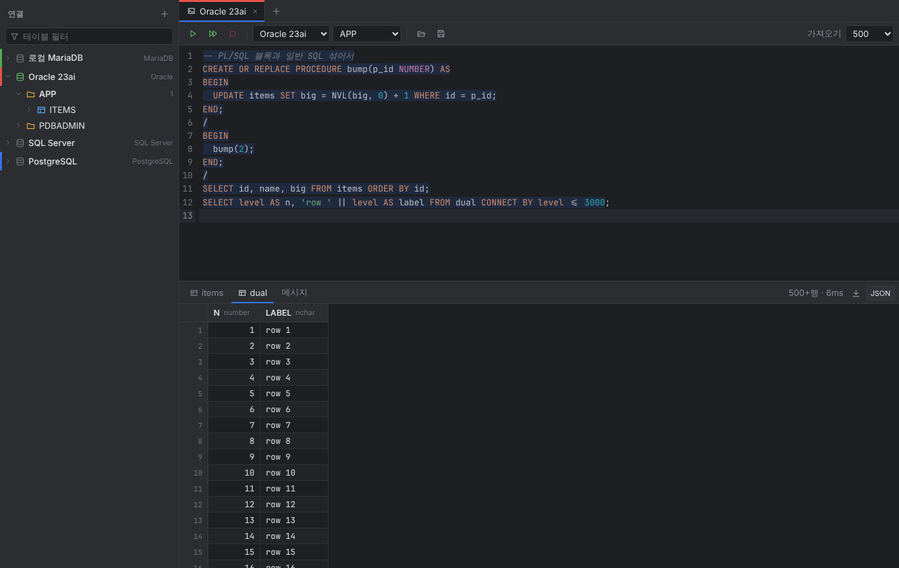

# Tablume

A lightweight cross-platform multi-database SQL client written in Go.

DataGrip보다 가볍게 쓰려고 만든 데이터베이스 클라이언트입니다. macOS와 Windows에서 동작합니다.



- **지원 DB**: MySQL, MariaDB, Oracle, SQL Server, PostgreSQL, SQLite
- **크기**: 실행 파일 하나, 약 35MB. JVM이나 Chromium을 함께 넣지 않고 OS에 있는 웹뷰를 씁니다. (Windows는 WebView2, macOS는 WKWebView)
- **Oracle Instant Client가 필요 없습니다.** 순수 Go 드라이버([go-ora](https://github.com/sijms/go-ora))를 씁니다.

## 기능

- 연결 관리: 연결별 색상 지정, 연결 테스트, 비밀번호는 OS 키체인에 저장 (macOS 키체인, Windows 자격 증명 관리자)
- SSH 터널: 비밀번호 또는 키 파일(암호 걸린 키 포함)로 접속합니다. 처음 연결한 SSH 서버의 호스트 키를 저장해 두고, 키가 바뀌면 연결하지 않습니다. 연결이 끊기면 다음 쿼리 때 다시 붙습니다.
- 스키마 트리: 스키마/DB → 테이블/뷰 → 컬럼 (PK, 타입, NOT NULL 표시)
- 프로시저·함수: 스키마 아래 "프로시저 · 함수"를 펼치면 목록이 나오고(Oracle은 패키지 포함, SQLite 제외), 누르면 소스(CREATE 문)가 콘솔 미리보기 탭에 열립니다. 소스는 그대로 다시 실행할 수 있게 MySQL은 `DELIMITER`, SQL Server는 `GO`, Oracle은 `/`로 감쌉니다.
  - 테이블 필터
  - 더블클릭하면 데이터 보기
  - 우클릭 메뉴: SELECT 문 생성, 이름 복사 등
- SQL 콘솔 (탭 여러 개, 탭마다 연결과 세션이 따로 유지됨)
  - `Ctrl/⌘+Enter`: 커서가 있는 문장을 실행하고, 선택 영역이 있으면 선택 영역을 실행
  - `Ctrl/⌘+Shift+Enter`: 전체 스크립트를 순서대로 실행하고, 오류가 나면 멈춤
  - 실행 중인 쿼리 취소. 서버가 취소에 응답하지 않으면 3초 뒤 그 탭의 연결을 새로 엽니다.
  - DB별 문법 하이라이트, 테이블/컬럼 자동완성
  - 문장을 나누는 규칙은 DB별로 다릅니다.
    - Oracle: PL/SQL 블록은 `/` 줄까지를 한 문장으로 봅니다.
    - SQL Server: `GO`로 배치를 나눕니다.
    - MySQL: `DELIMITER`를 지원하고, `BEGIN … END` 블록은 그대로 실행할 수 있습니다.
    - PostgreSQL: `$$` 인용을 인식합니다.
  - Oracle에서 PL/SQL을 CREATE했는데 컴파일 오류가 있으면 오류 내용을 보여줍니다. (SQL\*Plus의 "created with compilation errors"에 해당)
  - 탭과 SQL은 앱을 다시 켜도 복원됩니다. `.sql` 파일을 열고 저장할 수 있습니다.
- 결과 그리드
  - 가상 스크롤이라 수만 행도 가볍게 표시됩니다.
  - 처음에 500행(설정 가능)만 가져오고, 스크롤하면 이어서 가져옵니다.
  - 셀과 범위 선택, 복사(TSV, 헤더 포함, `IN (…)` 목록)
  - 컬럼 정렬과 너비 조절
  - 값 보기 창(JSON 정렬 지원)
  - CSV/JSON으로 내보내기
- 결과 그리드에서 바로 편집 (DataGrip 방식)
  - 단일 테이블 SELECT 결과이고, 결과에 기본 키(PK)가 모두 들어 있을 때 편집할 수 있습니다. 조건이 안 맞으면 "읽기 전용" 표시와 함께 이유를 보여줍니다.
  - PK가 없는 테이블도 행 추가는 됩니다. 기존 행의 수정·삭제만 막힙니다.
  - 셀 수정, NULL로 설정, 행 추가, 행 삭제를 화면에 모아 두었다가 "적용"을 누르면 실행될 SQL을 미리 보여주고, 한 트랜잭션으로 실행합니다.
  - 변경이 예상한 행 수(1행)와 다르게 적용되면 전체를 롤백합니다.
- DDL 보기: 테이블을 우클릭하고 "DDL 보기"를 누르면 새 탭에 CREATE 문이 열립니다. `SQL | 표` 전환으로 컬럼 구조(키, 타입, NULL, 기본값, FK, 코멘트)를 표로 볼 수도 있습니다.
  - MySQL: `SHOW CREATE TABLE`
  - Oracle: `DBMS_METADATA`
  - PostgreSQL, SQL Server: 시스템 카탈로그로 조립합니다(제약조건, 인덱스 포함).
  - SQLite: `sqlite_master`
- 트리 보기 옵션: 테이블·컬럼 코멘트, 행 수, 크기를 트리에 표시할 수 있습니다. 행 수와 크기는 `COUNT(*)`가 아니라 DB 통계에서 가져오는 추정값입니다. Oracle 크기는 로그인한 사용자 자신의 스키마에서만 보입니다.
- 트리 조작
  - 테이블을 클릭하면 미리보기 탭으로 열리고(다음 클릭이 같은 탭을 재사용), 더블클릭하면 탭이 고정됩니다. Enter로도 열 수 있습니다.
  - ↑↓로 이동, →로 펼치기, ←로 접기를 할 수 있습니다.
  - 열려 있는 테이블은 트리에서 강조 표시됩니다. 트리 위의 ⌖ 버튼을 누르면 그 위치로 펼쳐서 이동합니다.
  - 테이블이나 컬럼에 마우스를 올리면 코멘트 전체와 행 수, 크기가 보입니다.
  - 보기 옵션의 "기본 정렬: PK 내림차순"을 켜면 테이블을 열 때 PK 내림차순으로 정렬합니다.
- 탭은 드래그해서 순서를 바꿀 수 있습니다.
- 테이블 데이터 탭: 트리에서 테이블을 더블클릭하면 에디터 없이 결과만 보이는 탭이 열립니다. 위쪽의 `데이터 | DDL | 로그`로 전환할 수 있고, 콘솔 아이콘을 누르면 같은 SELECT를 SQL 콘솔에서 엽니다.
  - 결과는 콘솔과 테이블 탭 모두 페이지 단위로 가져옵니다. 단순 SELECT에는 `LIMIT/OFFSET`(SQL Server·Oracle 12c+는 `OFFSET … FETCH`)을 붙여 페이지마다 따로 실행하므로, 커서를 열어 둔 채 테이블 잠금을 잡지 않습니다. 이미 `LIMIT`/`TOP`/`FOR UPDATE` 등이 있는 쿼리나 Oracle 11g는 커서로 이어 읽고, 30초 동안 더 읽지 않으면 커서를 닫습니다.
  - 아래로 스크롤하면 다음 페이지를 붙이고, 위쪽 행은 맨 위의 "이전 행 불러오기"를 눌러 붙입니다. 메모리를 아끼려고 한 번에 최대 1만 행(페이지 크기가 크면 그 두 배)만 들고 있습니다.
  - 결과 막대: ⏮ 처음 · ◀ ▶ 한 페이지씩 이동(버튼은 쌓지 않고 그 페이지를 새로 불러옵니다) · `1–1,000 ▾`(누르면 페이지 크기 100~10,000 선택) · `1,001+`(누르면 `COUNT(*)`로 전체 행 수) · ⏭ 마지막.
- 결과 표 컬럼
  - 헤더를 드래그하면 컬럼 순서가 바뀌고, 헤더 우클릭이나 표 왼쪽 위 모서리 버튼으로 컬럼을 숨기거나 다시 보일 수 있습니다. 테이블 탭은 다시 조회해도 순서와 숨김이 유지됩니다.
  - 보기 옵션의 "컬럼 번호 표시"를 켜면 헤더에 컬럼 번호가 붙습니다.
  - 셀 하나를 선택하면 같은 컬럼에서 값이 같은 셀이 노랗게 강조되고, 선택한 셀의 `…` 버튼으로 큰 창에서 값을 보거나 편집합니다.
- 그리드 표시
  - 숫자, 날짜, 불리언 값을 색으로 구분합니다. FLOAT/DOUBLE은 지수 표기(`2.6e+25`) 없이 그대로 보여줍니다.
  - `Ctrl`+휠, `Ctrl`+`+`/`-`/`0`으로 표를 확대·축소합니다.
  - 헤더와 트리의 컬럼에 PK(🔑), UNIQUE(☆), FK(🔗) 아이콘을 붙이고, FK는 참조 대상을 툴팁으로 보여줍니다.
- 내보내기: CSV, TSV, JSON, INSERT 문(.sql)
- 테이블 필터를 입력하면 일치하는 테이블이 있는 스키마만, 펼친 상태로 보여줍니다.
- 테이블 데이터 필터 (DataGrip 방식)
  - 테이블 데이터 탭 위의 `WHERE` / `ORDER BY` 칸에 조건을 넣고 Enter를 누르면 DB에서 다시 조회합니다. 두 칸 모두 컬럼명과 키워드를 자동완성합니다(`Ctrl+Space`로 직접 띄울 수도 있습니다).
  - 행 수 제한 없이, 스크롤하면 끝까지 이어서 불러옵니다.
  - 컬럼 헤더를 클릭하면 DB 쪽 `ORDER BY`로 정렬합니다. 오름차순 → 내림차순 → 해제 순으로 바뀝니다.
  - 일반 쿼리 결과에서 헤더를 클릭하면 이미 불러온 행만 화면에서 정렬합니다.
- 결과만 크게 보기: 결과 탭 줄의 확대 버튼을 누르거나 구분선을 더블클릭하면 에디터를 숨기고 그리드만 크게 봅니다. 테이블 데이터 탭은 이 모드로 열립니다.
- 팝업 창은 제목 줄을 드래그해서 옮길 수 있습니다. 제목 줄을 더블클릭하면 가운데로 돌아옵니다.
- 테마: 보기 옵션에서 자동(OS 설정 따름) / 다크 / 라이트를 고를 수 있습니다.

## 단축키

| 키 | 동작 |
|---|---|
| `Ctrl/⌘ + Enter` | 현재 문장(또는 선택 영역) 실행 |
| `Ctrl/⌘ + Shift + Enter` | 전체 실행 |
| `Ctrl/⌘ + T` / `Ctrl/⌘ + W` | 새 콘솔 / 탭 닫기 |
| `Ctrl/⌘ + 1…9` | 탭 이동 |
| `Ctrl + Tab` / `Ctrl + Shift + Tab` | 다음 / 이전 탭 (`Ctrl + PageDown/PageUp`, macOS는 `⌘ + Shift + ]/[`도 됨) |
| `Ctrl/⌘ + /` | 주석 토글 |
| `Ctrl/⌘ + F` | 에디터에서 찾기/바꾸기 |
| 그리드에서 `Enter` / `F2` / 더블클릭 | 셀 편집 (편집할 수 없으면 값 보기) |
| 그리드에서 바로 타이핑 | 셀 값을 새 값으로 덮어쓰며 편집 시작 |
| 그리드에서 `Shift + Enter` | 셀 값 보기 |
| 그리드에서 `Delete` | 선택한 행 삭제 / 복원 (적용 전까지 보류) |
| 그리드에서 `Ctrl/⌘ + S` | 변경 적용 |
| 탭 더블클릭 / 가운데 클릭 | 이름 바꾸기 / 닫기 |

## DB별 참고

- **Oracle**: "서비스 이름"(예: `ORCL`, `FREEPDB1`, `XEPDB1`)으로 접속하고, 필요하면 "SID 사용"을 체크하세요. 11g도 지원합니다. 테이블 미리보기는 `ROWNUM`을 씁니다. 스키마 목록은 12c 이상에서 Oracle 내부 계정(SYS, XDB 등)을 숨깁니다.
- **SQL Server**: 트리의 첫 단계는 데이터베이스입니다. 이름 있는 인스턴스는 호스트에 `host\SQLEXPRESS`처럼 적으면 됩니다. 기본값은 `TrustServerCertificate=true`입니다.
- **MySQL/MariaDB**: 영향받은 행 수는 실제로 바뀐 행이 아니라 조건에 맞은 행 기준입니다(`clientFoundRows`).
- **추가 옵션** 칸에 드라이버 옵션을 `key=value&key2=value2` 형식으로 넣을 수 있습니다. 예: `tls=true`, `sslmode=require`, `encrypt=true`
- 트랜잭션: 기본은 autocommit입니다. 탭마다 연결이 하나로 고정되어 있어서 `BEGIN`/`START TRANSACTION` … `COMMIT`/`ROLLBACK`을 직접 실행해도 같은 세션에서 처리됩니다.

## 개발

필요한 것: Go 1.24 이상, Node 20 이상, [Wails v2](https://wails.io) CLI

```bash
go install github.com/wailsapp/wails/v2/cmd/wails@latest
```

```bash
wails dev
```

```bash
wails build
```

- `wails dev`: 핫 리로드로 개발합니다. 브라우저에서 http://localhost:34115 를 열어도 됩니다.
- `wails build`: 지금 쓰는 OS용으로 빌드합니다. 결과물은 `build/bin/`에 생깁니다.
- 리눅스에서 빌드하려면 `libgtk-3-dev`, `libwebkit2gtk-4.1-dev`가 있어야 하고, `-tags webkit2_41` 옵션을 붙여야 합니다.
- Windows용 `.exe`는 리눅스나 macOS에서도 `wails build -platform windows/amd64`로 만들 수 있습니다.
- macOS 메뉴 막대(Tablume / 편집 / 윈도우)는 한국어로 나옵니다. Wails가 영어로 만드는 메뉴 제목은 `menu_darwin.go`에서 바꾸고, macOS가 직접 넣는 항목(서비스, 받아쓰기 시작 등)은 `build/darwin/Info.plist`의 한국어 지역화 설정으로 한국어가 됩니다.
- macOS 앱은 macOS에서만 빌드할 수 있습니다. 직접 빌드하기 어렵다면 아래 GitHub Actions를 쓰세요.

### GitHub Actions로 배포 파일 만들기

`.github/workflows/build.yml`은 `v*` 태그를 푸시하거나 Actions 탭에서 수동으로 실행하면 돌아갑니다. macOS(Apple Silicon) `.app` zip과 Windows `.exe`를 만들어 아티팩트로 올립니다.

macOS 빌드는 서명되지 않았기 때문에 처음 실행할 때 Finder에서 우클릭 → 열기를 하거나, 다음 명령을 실행해야 합니다.

```bash
xattr -dr com.apple.quarantine Tablume.app
```

### 테스트

```bash
go test ./internal/...
```

이 명령은 SQL 문장 분리기만 단위 테스트합니다. 실제 DB 5종에 대한 통합 테스트는 아래 순서로 실행합니다. 먼저 Docker로 테스트용 DB를 띄웁니다.

```bash
docker run -d --name t-maria -e MARIADB_ROOT_PASSWORD=pw -e MARIADB_DATABASE=shop -p 3306:3306 mariadb:11
```

```bash
docker run -d --name t-pg -e POSTGRES_PASSWORD=pw -p 5432:5432 postgres:17-alpine
```

```bash
docker run -d --name t-ora -e ORACLE_PASSWORD=pw -e APP_USER=app -e APP_USER_PASSWORD=pw -p 1521:1521 gvenzl/oracle-free:slim-faststart
```

```bash
docker run -d --name t-mssql -e ACCEPT_EULA=Y -e 'MSSQL_SA_PASSWORD=Passw0rd!' -p 1433:1433 mcr.microsoft.com/mssql/server:2022-latest
```

DB가 모두 뜨면 통합 테스트를 실행합니다.

```bash
TABLUME_IT=1 go test ./internal/dbx/ -v
```

## 구조

```
main.go, app.go            Wails 진입점과 프론트엔드에 노출하는 API
internal/dbx/              DB 계층
  dialect.go               DB별 접속 문자열과 메타데이터 쿼리
  manager.go               연결 풀, 탭별 세션, 실행/취소/커서
  split.go                 SQL 스크립트를 문장 단위로 나누기 (DB별 규칙)
internal/store/            연결 목록(JSON)과 키체인 연동
frontend/                  Svelte 5 + CodeMirror 6 UI
```

설정 파일 위치:

- macOS: `~/Library/Application Support/Tablume/`
- Windows: `%AppData%\Tablume\`

## 다음에 하면 좋을 것

- 수동 커밋 모드 토글
- 쿼리 히스토리
- 인덱스/제약조건 트리

## 라이선스

[MIT](LICENSE)
