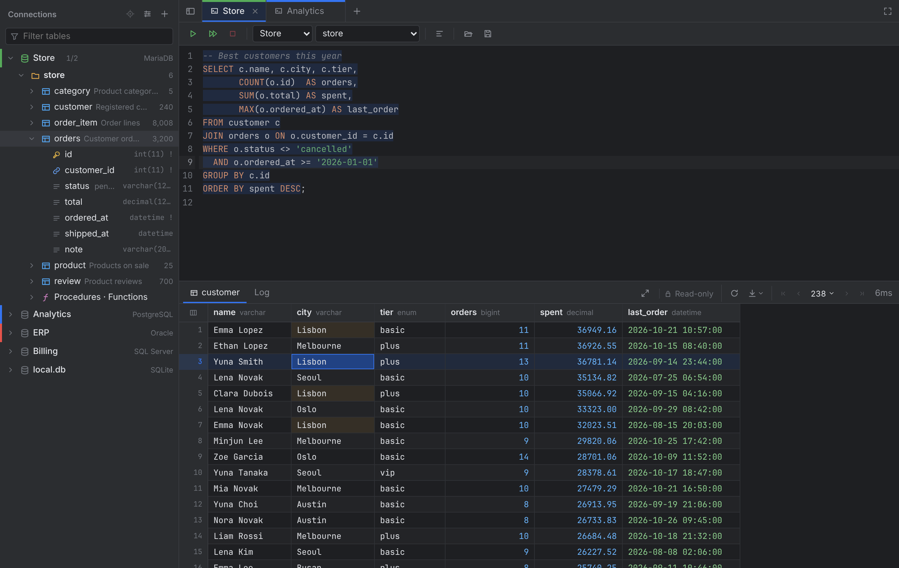
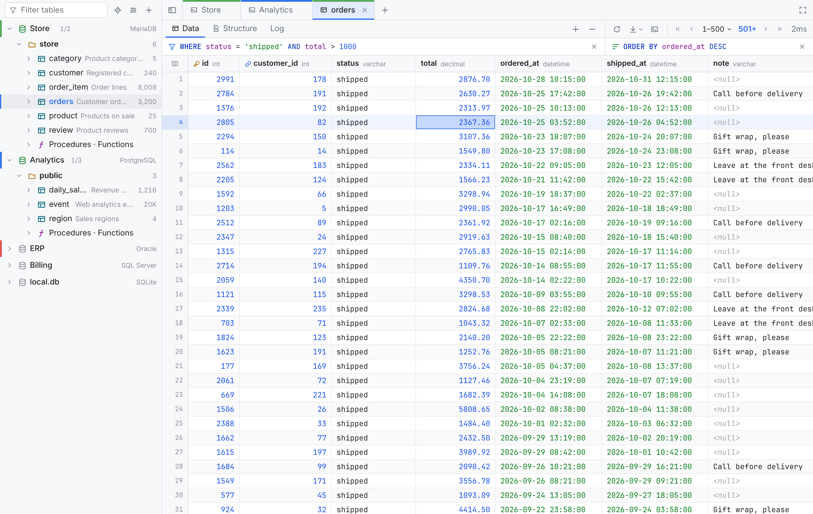

# Tablume

**English** | [한국어](README.ko.md)

A lightweight cross-platform multi-database SQL client written in Go.

Built as a lighter alternative to DataGrip. It runs on macOS and Windows, and there is also a [web version](#web-version) you run on a server and use from a browser.



- **Databases**: MySQL, MariaDB, Oracle, SQL Server, PostgreSQL, SQLite
- **Size**: a single executable, about 35 MB. No bundled JVM or Chromium: it uses the web view that comes with the OS (WebView2 on Windows, WKWebView on macOS).
- **No Oracle Instant Client needed.** It uses a pure Go driver ([go-ora](https://github.com/sijms/go-ora)).

## Features

### Connections

- A color per connection and a connection test. Passwords are kept in the OS keychain (macOS Keychain, Windows Credential Manager).
- SSH tunnels with a password or a key file (passphrase-protected keys too). The server's host key is saved on the first connection and a changed key is refused. A dropped tunnel reconnects on the next query.
- Reorder connections by dragging, or right-click → Move to Top / Up / Down / to Bottom.
- **Read-only connections**: with "Read-only" on in a connection's settings, the console runs only statements that read (SELECT, SHOW, EXPLAIN, …), checked for the whole script before anything runs; data edits, structure changes and creating or dropping tables and schemas are refused. MySQL/MariaDB, PostgreSQL and SQLite sessions are opened read-only too, which also stops functions that write. The tree and tabs show a lock.
- **Export and import connections**: View options → Connections exports every connection to a JSON file and imports one (a single connection: right-click → Export). The file has SSH, color, shown schemas and extra options, but no passwords (nor the SSH password or key passphrase); an imported connection asks for its password on connecting. A connection that matches one already saved isn't added again.

### Schema tree

- Connection → schema/database → tables/views → columns, with PK (🔑), UNIQUE (☆) and FK (🔗) icons.
- `3/98` (shown/total) next to a connection chooses the schemas to show: all (system schemas excluded), the default one, individual schemas and patterns like `HR_*`, saved per connection.
- Clicking a table opens it in a preview tab that the next click reuses; double-click keeps it. A table that is already open switches to its tab, and ⌖ above the tree finds the open table.
- Connections and schemas expand with ▸ or a double-click; the keyboard works too (↑↓ move, → expand, ← collapse). The current connection's name stays pinned at the top while scrolling.
- The table filter shows only schemas with matching tables, among the ones already loaded.
- View options can add schema, table and column comments, row counts and sizes. Counts and sizes are estimates from the database statistics, fetched only while the option is on; a full count in a table tab updates the tree.
- Hovering a table or column shows its comment, row count and size.
- "Procedures · Functions" under a schema lists routines (packages on Oracle; not SQLite). Clicking one opens its source in a console, wrapped to run as is (`DELIMITER`, `GO`, `/`).
- Table menu: view data, view DDL, put a SELECT in the console, copy names, rename (`F2`; open tabs follow), export data, import a CSV, empty the table, drop the table or view. Emptying (`TRUNCATE`; `DELETE` on SQLite) and dropping ask first, and tabs of a dropped table close.
- Schema menu: create a table, table and routine lists (comments, row counts, sizes, dates and more from the catalog, opened as a grid you can sort, filter and export), ERD (MySQL/MariaDB), edit the comment, export the schema, drop the schema.
- Schema comments: a database's comment on MariaDB (10.5+), `COMMENT ON SCHEMA` on PostgreSQL and a database's `MS_Description` property on SQL Server (SSMS's "Description") show in the tree, its tooltips and the schema picker, and "Edit comment…" in the schema menu changes them. MySQL, Oracle and SQLite have no schema comments.
- Creating and dropping schemas: schemas on PostgreSQL (`DROP SCHEMA … CASCADE`), databases on MySQL/MariaDB and SQL Server. Creating is in the connection and schema menus; dropping asks first and isn't offered for system schemas. Not on Oracle or SQLite.
- DDL run in a console (`CREATE`/`ALTER`/`DROP`/`RENAME`, `CREATE DATABASE`/`SCHEMA`) reloads the affected parts of the tree.

### SQL console

- Any number of tabs, each with its own connection and session. Tabs and their SQL come back after a restart; `.sql` files can be opened and saved.
- Run the statement at the cursor (or the selection), or the whole script, stopping at an error. A running query can be cancelled; if the server ignores the cancel, the tab's connection is reopened after 3 seconds.
- Syntax highlighting and table/column completion per database, and SQL formatting.
- Statements are split by each database's rules: PL/SQL blocks up to `/` (Oracle), `GO` batches (SQL Server), `DELIMITER` and `BEGIN … END` (MySQL), `$$` quoting (PostgreSQL). A comment after `;` on the same line belongs to that statement.
- **Manual commit**: `Tx: Auto / Manual` in the toolbar keeps changes in a transaction until Commit or Rollback. The transaction begins before the first change and DDL ends it (MySQL and Oracle commit on DDL). Closing the tab, disconnecting or switching back to auto with changes pending asks first; a lost connection says the changes were rolled back.
- On any connection, an `UPDATE` or `DELETE` without a `WHERE` of its own isn't run straight away: it shows the statements and asks first.
- On Oracle, PL/SQL created with compilation errors shows the errors, like SQL\*Plus.
- Closing a console whose SQL was edited (since it was opened or last saved to a file) asks first.

### Results

- The time next to a result is the whole wait: execution, fetching, the app's own share and drawing the grid; hovering it shows each part.
- Results are fetched a page at a time (500 rows by default, 100–10,000). Plain SELECTs get `LIMIT/OFFSET` (`OFFSET … FETCH` on SQL Server and Oracle 12c+), so no cursor stays open holding locks. Other queries and Oracle 11g read on from a cursor, closed after 30 seconds without reading.
- Scrolling loads more; at most 10,000 rows are kept, and "Load previous rows" brings back earlier ones. The result bar pages through, changes the page size and counts all rows (`COUNT(*)`).
- Virtual scrolling, cell and range selection, copy as TSV, with headers or as an `IN (…)` list. Selecting a cell highlights equal values in its column.
- Columns can be resized (double-click a border to fit the contents), reordered by dragging and hidden; table tabs keep that layout. Clicking a header sorts.
- `Ctrl/⌘+F` finds text in the loaded rows; `Enter` / `Shift+Enter` go to the next / previous match.
- Numbers, dates and booleans are colored; FLOAT/DOUBLE are shown without exponent notation.
- The value viewer highlights JSON (folding, bracket matching) and can format it.
- `⌘`+click (Mac) or `Alt`/`Ctrl`+click (Windows) on an FK cell opens the referenced row in a new tab; so does "Open Referenced Row" in the cell menu.
- Export to CSV, TSV, JSON or INSERT statements.
- The editor can be hidden to give the grid the whole tab (the maximize button, or double-click the divider).

### Table tabs

- A table opens as a grid-only tab with `Data | Structure | Log`; the console icon opens its SELECT in a console.
- `WHERE` and `ORDER BY` fields above the grid (DataGrip style) query the database again on Enter, with completion of columns and keywords. Header clicks sort in the database too (ascending → descending → off); in a console result they sort the loaded rows.
- "Default order: PK descending" in the view options opens tables newest first.
- Table tabs have the `Tx: Auto / Manual` switch too. In manual commit, applied grid edits join the tab's transaction and wait for Commit (each apply is all-or-nothing through a savepoint); a rollback reads the table again.

### Run log

- The log pane can be searched and switches between `This tab | Whole connection`.
- Lines with SQL are saved per connection in the data folder (the last ~3,000), so they outlive tabs and restarts: console statements as written, grid edits and structure changes as run. Statements that may hold a password aren't saved. Queries the app made (a table tab's SELECT, paging) are dimmed.
- A button on each line puts its statement in the console. "Run log" in the connection menu opens the log in a new console; deleting a connection deletes its log.

### Editing data

- Results of a single-table SELECT that include the whole primary key can be edited; otherwise the grid says "Read-only" and why. Without a primary key, rows can still be added.
- Cell edits, NULL, added and deleted rows wait on screen and run in one transaction on "Apply". If a change hits a different number of rows than one, everything is rolled back. Applied statements are logged as highlighted SQL.
- Edited cells can be reverted one by one. `Tab` moves to the next cell while editing, and long text continues in a large editor.
- Empty columns of a new row show `<generated>` or `<default>` and are left out of the INSERT. A cell left without typing stays NULL; one typed in and cleared becomes `''` (Oracle stores that as NULL).

### Structure

- "Structure" shows a table's columns (key, type, NULL, default, comment), indexes and foreign keys, or its DDL (`SHOW CREATE TABLE`, `DBMS_METADATA`, the system catalogs, `sqlite_master`). A column's key or index icon leads to that index or foreign key.
- Name, type, NULL, default and comment are changed in place. Each column's edit dialog also takes comments over several lines, auto increment (existing columns on MySQL/MariaDB and PostgreSQL, new columns everywhere) and, on MySQL/MariaDB, collation, ON UPDATE and INVISIBLE. Columns can be added and dropped and the table renamed or its comment changed; on MySQL/MariaDB columns are dragged into another order and the engine can be changed.
- "Apply" shows the `ALTER` statements first. PostgreSQL and SQL Server run them in one transaction; MySQL/MariaDB and Oracle can't roll back DDL, so the preview warns that a failure leaves earlier statements applied. On MySQL, `MODIFY` keeps the column's character set, collation, AUTO_INCREMENT, ON UPDATE and INVISIBLE.
- Foreign keys are listed with their ON UPDATE / ON DELETE rules, added and dropped (MySQL/MariaDB, PostgreSQL, SQL Server, Oracle).
- Indexes can be added (columns in order, `idx_table_column` suggested), changed (dropped and created again) and dropped. The primary key is left alone, constraint-backed indexes are dropped with `DROP CONSTRAINT`, and indexes with expressions, prefix lengths, conditions or INCLUDE can only be dropped.
- "Create table" in the schema menu uses the same view: the table's name, comment, (MySQL/MariaDB) engine, columns and primary key, run as `CREATE TABLE`. Indexes and foreign keys are then added in that tab.
- SQLite: creating tables, and adding, renaming and dropping columns, which is what its `ALTER TABLE` does. Type, NULL and default can't be changed and there are no comments. Views are read-only on every database.
- Every preview can also be opened in a console instead of being run.

### Exporting and importing data

- Table menu → "Export data…" writes CSV, JSON or SQL (`CREATE` and/or `INSERT`), streaming the whole table from the database to the file (a download in the web version). CSV gets a UTF-8 BOM so Excel opens it as is.
- Schema menu → "Export schema…" writes the schema's tables as SQL, referenced tables first.
- Table menu → "Import CSV…" reads a UTF-8 or CP949 file, matches columns by name and inserts every row in one transaction.

### ERD

- On MySQL/MariaDB, schema menu → "Show ERD" draws the tables and their foreign keys, parents on the left, each relation marked 1:1 or 1:N and required or optional. A line that skips columns of boxes runs through the gaps between them.
- Zoom, pan and fit (pinch on a touch screen); hovering a table, a column or a line highlights what it's related to.
- Boxes can be moved and widened; "Auto arrange" puts them back. A box's menu opens its data or DDL.
- Options show all columns, comments, NULL and AUTO_INCREMENT marks and tables without relations. Audit columns such as `created_*` and `updated_*` are hidden by default, and which names count as audit columns is set as patterns.

### Interface

- Language (English / 한국어; the OS language at first), theme (Auto / Dark / Light) and zoom (`[−][100 ▾][+]`, ±5% or presets 100–200%) in the view options.

  

- The connection list can be hidden (`Ctrl/⌘+B`), and "Wide View" shows only the current tab across the window.
- Tabs can be reordered by dragging; the tab menu closes groups of tabs, duplicates, renames and (desktop app) opens a tab in a window of its own.
- Dialogs can be dragged by their title bar.
- The desktop app reopens at the window size it was closed at.
- **Updates**: at startup the app asks GitHub whether a newer version is out and says so once per release ("Download" opens the release page). "Check for updates" in the view options checks right away, and "Check for updates at startup" turns it off. Nothing is downloaded or installed by the app.

## Shortcuts

| Key | Action |
|---|---|
| `Ctrl/⌘ + Enter` | Run the current statement (or the selection) |
| `Ctrl/⌘ + Shift + Enter` | Run all |
| `Ctrl/⌘ + T` / `Ctrl/⌘ + W` | New console / close tab |
| `Ctrl/⌘ + B` | Hide / show the connection list (in wide view: back to the normal view) |
| `Ctrl/⌘ + 1…9` | Go to tab |
| `Ctrl + Tab` / `Ctrl + Shift + Tab` | Next / previous tab (also `Ctrl + PageDown/PageUp`, and `⌘ + Shift + ]/[` on macOS) |
| `Ctrl/⌘ + /` | Toggle comment |
| `Ctrl + Alt + L` / `⌘ + ⌥ + L` | Format SQL (selection or everything) |
| `Ctrl/⌘ + F` | Find/replace in the editor |
| `Enter` / `F2` / double-click in the grid | Edit the cell (view the value if it can't be edited) |
| Typing in the grid | Start editing, replacing the cell's value |
| `Shift + Enter` in the grid | View the cell value |
| `F2` while editing a cell | Continue in the large editor |
| `Delete` in the grid | Delete / restore the selected rows (pending until applied) |
| `Ctrl/⌘ + S` in the grid | Apply changes |
| `Ctrl/⌘ + F` in the grid | Find in the loaded rows |
| Double-click a column border | Fit the column to its contents |
| `Ctrl/⌘ + ↓` on a schema in the tree | Open its table list |
| `Esc` | Close an open menu |
| Double-click / middle-click a tab | Rename / close |

## Notes per database

- **Oracle**: connect with a "Service name" (e.g. `ORCL`, `FREEPDB1`, `XEPDB1`), or check "Use SID". 11g is supported; table previews use `ROWNUM`. On 12c and later the schema list hides Oracle's internal accounts (SYS, XDB, …).
- **SQL Server**: the tree's first level is databases. For a named instance, write the host as `host\SQLEXPRESS`. `TrustServerCertificate=true` is the default.
- **MySQL/MariaDB**: affected row counts are rows matched, not rows actually changed (`clientFoundRows`).
- **MySQL/MariaDB TLS**: `tls=true` in the extra options verifies the server certificate with the OS. For a certificate from your own CA (which macOS rejects more strictly), add `tls-ca=/path/ca.pem`; `tls=skip-verify` encrypts without verifying (DataGrip's default). Through an SSH tunnel the certificate is still checked against the database host name.
- **Extra options** take driver options as `key=value&key2=value2`, e.g. `tls=true`, `sslmode=require`, `encrypt=true`.
- Transactions: autocommit by default; the `Tx` switch in consoles and table tabs turns on manual commit. Each tab keeps one connection, so `BEGIN`/`START TRANSACTION` … `COMMIT`/`ROLLBACK` typed by hand run in the same session.

## Web version

The same app, run on a server and used from a browser (like dbgate's web version). Sign-in is with passkeys: Touch ID / Face ID on Mac and iPhone, Windows Hello (PIN, fingerprint, face) on Windows.

- There is one account. Every device signed in sees the same connection list and workspace (open tabs, SQL).
- The server connects to the databases, so only databases the server can reach are available.
- Phones and tablets work too. A long press opens the right-click menus, and a tab is moved by holding it, then dragging. At 700px wide or less the connection list opens as a drawer over the content and closes once a table is picked.

### Running

Docker:

```bash
docker build -t tablume .
```

```bash
docker run -d --name tablume --restart unless-stopped -p 127.0.0.1:8080:8080 -v tablume:/data -e TABLUME_URL=https://db.example.com tablume
```

Or run the executable directly. This builds `build/bin/Tablume-server`:

```bash
wails3 task build:server
```

```bash
./build/bin/Tablume-server -url https://db.example.com
```

| Option | Environment variable | Default | Description |
|---|---|---|---|
| `-url` | `TABLUME_URL` | (optional on localhost) | The address typed in the browser. Passkeys are bound to its domain. Must be HTTPS (except localhost). |
| `-listen` | `TABLUME_LISTEN` | `127.0.0.1:8080` (Docker: `:8080`) | Address the server listens on |
| `-data` | `TABLUME_DATA` | the OS config folder (Docker: `/data`) | Connection list, workspace, passkeys, encryption key |
| `-files` | `TABLUME_FILES` | `<data>/files` | The only folder SQLite files and SSH keys are read from |
| `-reset-passkeys` | | | Remove every passkey, sign every device out and print a new setup link |
| `-version` | | | Print the version and exit |

The executable is statically linked and needs nothing else installed. With systemd, a unit like this works:

```ini
[Unit]
Description=Tablume
After=network-online.target
Wants=network-online.target

[Service]
User=tablume
Environment=TABLUME_URL=https://db.example.com
Environment=TABLUME_LISTEN=127.0.0.1:8080
Environment=TABLUME_DATA=/var/lib/tablume
ExecStart=/usr/local/bin/tablume-server
Restart=on-failure

[Install]
WantedBy=multi-user.target
```

### First sign-in

1. With no passkeys yet, the server prints a setup address in its log (`docker logs tablume`, `journalctl -u tablume`). It looks like `https://…/login?token=…` and changes when the server restarts.
2. Open it and click "Register a Passkey on This Device".
3. Other devices:
   - Apple devices share passkeys through iCloud Keychain and can sign in right away.
   - On a Windows PC, the sign-in page can use your phone's passkey by scanning a QR code.
   - To create a passkey (Windows Hello) on the PC itself, open View options → Account → "Manage Passkeys" → "Create Setup Link" on a signed-in device and open the one-time link (15 minutes) on the PC.
4. "Manage Passkeys" renames and deletes passkeys. Devices signed in with a deleted passkey are signed out. The last one can't be deleted.
5. A sign-in lasts 30 days from its last use.

### Reverse proxy

HTTPS is handled by a reverse proxy in front (nginx, Caddy, …). Two things must be set:

- The events WebSocket (`/wails/events`) has to pass through.
- Long queries answer late, so allow a generous read timeout (nginx's default is 60 seconds).

Caddy needs nothing extra:

```
db.example.com {
    reverse_proxy 127.0.0.1:8080
}
```

nginx:

```nginx
map $http_upgrade $connection_upgrade { default upgrade; '' close; }

server {
    server_name db.example.com;
    # listen 443 ssl; ssl_certificate …

    location / {
        proxy_pass http://127.0.0.1:8080;
        proxy_http_version 1.1;
        proxy_set_header Upgrade $http_upgrade;
        proxy_set_header Connection $connection_upgrade;
        proxy_read_timeout 1h;
        proxy_send_timeout 1h;
        client_max_body_size 50m;
    }
}
```

### Differences from the desktop app

- **Files**
  - SQLite files and SSH keys are picked only inside the server's files folder (`-files`). "Browse…" opens a browser of that folder. Other paths are refused when connecting.
  - For SQLite, a file name that doesn't exist creates a new database.
  - SQL can't reach other files either; this is enforced in the SQLite engine. `ATTACH` (except `:memory:`), `VACUUM INTO` and `PRAGMA temp_store_directory`/`data_store_directory` are refused, and extension loading (`load_extension`) is off. Only SQLite options that open no other file are accepted (`_pragma`, `_txlock`, `_time_format`, `_timezone`, `mode`, `cache`, `immutable`, `nolock`, `psow`).
  - The SSH key file can't be left empty: as in the desktop app that would mean `~/.ssh`, which here is the server's keys.
  - Saving `.sql` files and exporting results, data and connections are downloads; opening `.sql` files and importing CSV files or connections are uploads.
- **Screen**
  - "Wide View" takes the place of opening a tab in a new window.
  - Zoom is the browser's zoom (`Ctrl/⌘ + +/-`).
  - Shortcuts the browser takes first (`Ctrl/⌘+T`, `Ctrl/⌘+W`, `Ctrl/⌘+1…9`, `Ctrl+Tab`, …) aren't shown in menus and hints.
- **Passwords**
  - Saved passwords are AES-GCM encrypted in `connections.json` instead of an OS keychain, with the key in `secret.key` next to it, so whoever has the whole data folder can read them. Take care with its backups.
- **Database sessions**
  - Each browser page gets its own database sessions, so a phone and a PC open at once don't share transactions.
  - Closing a page closes its sessions (rolling back open transactions); pages that vanish without a word are cleaned up after 30 minutes.
  - The workspace (open tabs, SQL) is the one last saved, from whichever device.

### Security design

- The app itself runs on a random port on `127.0.0.1`. The only port open to the outside is the front door that checks sign-in.
- The app refuses requests without the secret header the front door adds.
- Requests from other sites (POSTs and WebSockets with another Origin) are refused even with the cookie.
- A signed-in user can connect (or test a connection) to any host and port the server can reach, and open SSH tunnels, because the server makes the database connections. Error messages also reveal whether ports on the internal network are open, so limiting the server's (container's) outbound firewall to the databases it needs is recommended.
- The update check is the server asking `api.github.com`. If that's blocked nothing else is affected, and turning off "Check for updates at startup" in the view options stops it. The answer is kept on the server for six hours.
- Other programs on the same server can, however, listen in on the app's events WebSocket (connection status notifications and the like), because Wails offers no way to check that path. This doesn't apply in a Docker container (other than with `--network host`).

## Development

Requirements: Go 1.26+, Node 20+, the [Wails v3](https://v3.wails.io) CLI

```bash
go install github.com/wailsapp/wails/v3/cmd/wails3@v3.0.0
```

```bash
wails3 dev
```

```bash
wails3 build
```

```bash
wails3 package
```

- `wails3 dev` runs with hot reload, `wails3 build` builds for the current OS into `build/bin/`, and `wails3 package` makes a release build (`Tablume.app` on macOS). The steps are in `Taskfile.yml`.
- The Go functions the frontend calls (`frontend/bindings/`) are generated from `internal/app/app.go` during the build. To generate them by hand, run `wails3 task bindings`.
- Building on Linux needs `libgtk-3-dev` and `libwebkit2gtk-4.1-dev`. Wails v3 defaults to GTK4, so the Taskfile adds the `gtk3` tag.
- A Windows `.exe` can be built on Linux or macOS too: `wails3 build GOOS=windows`.
- Builds can include only the databases you need: list the ones to leave out in `EXTRA_TAGS` (`no_mysql`, `no_postgres`, `no_mssql`, `no_oracle`, `no_sqlite`). With only MySQL/MariaDB, for example, the Windows `.exe` shrinks from about 38 MB to about 14 MB. Left-out databases don't appear when creating a connection, and saved connections to them explain why when connecting. GitHub Actions always makes full builds.

```bash
wails3 package EXTRA_TAGS=no_postgres,no_mssql,no_oracle,no_sqlite
```

- `wails3 task build:server` builds the [web version](#web-version). To try it locally, run it and register a passkey at the `http://localhost:8080/login?token=…` address in the log. Playwright tests use Chromium's virtual authenticator (CDP `WebAuthn.addVirtualAuthenticator`).
- The macOS menu bar (Tablume / Edit / Window) is built in `internal/app/menu.go` in the app's language and rebuilt when it changes. Items macOS adds itself (Services, Start Dictation, …) follow the OS language (`build/darwin/Info.plist` declares English and Korean).
- The macOS app can only be built on macOS. If that's not at hand, use GitHub Actions below.

### Version

The version is in the `VERSION` file. The Go build embeds it: the app shows it at the bottom of the view options menu, and `Tablume-server -version` prints it. The macOS and Windows files keep their own copies (`Info.plist`, `build/windows/info.json` and the manifest, plus `package.json`), so change the version with this task, which updates all of them:

```bash
wails3 task version VERSION=0.9.1
```

`wails3 package`, `wails3 task build:server` and the tests stop if the copies don't match `VERSION`. For a one-off build, `-ldflags "-X main.version=0.9.1-rc1"` overrides the version the binary reports.

### Release builds with GitHub Actions

`.github/workflows/build.yml` runs when a `v*` tag is pushed, or by hand from the Actions tab. It builds a macOS (Apple Silicon) `.app` zip and a Windows `.exe` and uploads them as artifacts. A tag must match `VERSION` (`v0.9.0` for `0.9.0`).

The macOS build isn't signed, so the first launch needs right-click → Open in Finder, or:

```bash
xattr -dr com.apple.quarantine Tablume.app
```

### Tests

```bash
go test ./internal/... ./build/...
```

```bash
CGO_ENABLED=0 go test -tags server .
```

These are unit tests (statement splitting, SQLite, translations, the web front door, file restrictions, version copies). Integration tests against the five databases run like this. First start test databases with Docker:

```bash
docker run -d --name t-maria -e MARIADB_ROOT_PASSWORD=pw -e MARIADB_DATABASE=shop -p 3306:3306 mariadb:11
```

```bash
docker run -d --name t-pg -e POSTGRES_PASSWORD=pw -p 5432:5432 postgres:17-alpine
```

```bash
docker run -d --name t-ora -e ORACLE_PASSWORD=pw -e APP_USER=app -e APP_USER_PASSWORD=pw -p 1521:1521 gvenzl/oracle-free:slim-faststart
```

```bash
docker run -d --name t-mssql -e ACCEPT_EULA=Y -e 'MSSQL_SA_PASSWORD=Passw0rd!' -p 1433:1433 mcr.microsoft.com/mssql/server:2022-latest
```

When they are all up, run the integration tests:

```bash
TABLUME_IT=1 go test ./internal/dbx/ -v
```

## Layout

```
main.go                    Entry point: embeds the built frontend, the icon and VERSION
VERSION                    App version (build/version/ keeps the copies in step)
Taskfile.yml               Build steps (wails3 build / package / dev)
internal/app/              The Wails app
  run.go                   Options, main window, start
  app.go                   API exposed to the frontend (App service)
  platform_desktop.go      Desktop-only setup
  platform_web.go          Web version (-tags server): options, front door, session cleanup
  files.go                 Web version: server file browsing and path restrictions
  tabwindows.go            Tabs opened in their own window
  windowstate.go           Main window size, kept between runs
  menu.go                  macOS menu bar
internal/dbx/              Database layer
  dialect.go               Common database interface and registration
  dialect_<db>.go          Per-database connection strings, metadata, DDL, column and index changes (leave out with the no_<db> build tag)
  manager.go               Connection pools, per-tab sessions, run/cancel/cursors
  split.go                 Splitting SQL scripts into statements (per-database rules)
internal/store/            Connection list (JSON) and keychain (encrypted in a file without one)
internal/web/              Web version front door: passkey sign-in (WebAuthn), sessions, proxy to the app
internal/i18n/             Backend message translations (en.go: English table)
frontend/                  Svelte 5 + CodeMirror 6 UI
  src/lib/i18n*.ts         Interface translations (i18n-en.ts: English table)
```

Translations: the Korean text is the key. The UI writes `t('새 콘솔')` and Go `i18n.T("…")` / `i18n.Errorf("…", …)`, and the English tables (`frontend/src/lib/i18n-en.ts`, `internal/i18n/en.go`) map the same text to English. `npm run check` (frontend) and `go test ./internal/i18n` (backend) list missing entries.

Settings are stored in:

- macOS: `~/Library/Application Support/Tablume/`
- Windows: `%AppData%\Tablume\`
- Web version: the folder given with `-data`

## Ideas for later

- A manual-commit mode toggle
- Query history
- Indexes/constraints in the tree
- Following multi-column foreign keys (today a single cell's value is looked up)

## License

[MIT](LICENSE)
